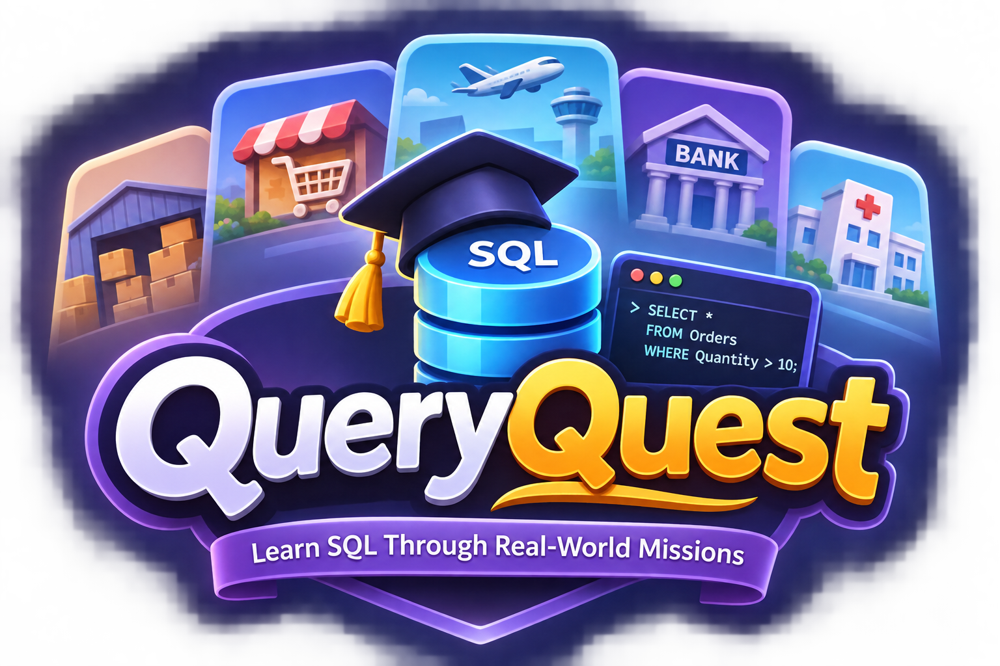

# Quest Query

<p align="center">
  
</p>

<p align="center">
  <strong>Real-world problems. Data-powered solutions.</strong>
</p>

<p align="center">
  <a href="https://query-quest-livid.vercel.app/"></a>
  <a href="https://github.com/shashaank747/QueryQuest"></a>
  <a href="#-data-tracks-hub"></a>
  <a href="#-industry-worlds--curriculum"></a>
  <a href="#-industry-worlds--curriculum"></a>
  <a href="#-technology-stack"></a>
  <a href="#-technology-stack"></a>
  <a href="#-test-suite-execution"></a>
  <a href="#-license"></a>
</p>

---

## 🌐 Live Application

Play **Quest Query** instantly in your browser with zero installation:  
👉 **[https://query-quest-livid.vercel.app/](https://query-quest-livid.vercel.app/)**

> **Zero Server Overhead**: The relational database engine runs client-side using **SQLite 3 compiled to WebAssembly**, and the spreadsheet simulation runs on an authentic **in-browser Excel formula compiler & evaluator**. All queries, spreadsheet calculations, schema mutations, and data persistence happen locally with 0ms server latency.

---

## 📖 Overview

**Quest Query** is an immersive enterprise data simulation platform where learners master real data tools by stepping into authentic organizations and solving live operational crises.

Traditional courses teach syntax in sterile isolation with trivial queries like `SELECT * FROM employees` or blank spreadsheet grids without business context. **Quest Query** places you inside realistic operational environments: you investigate actual corporate schemas, troubleshoot broken inventory pipelines, reconcile multi-terminal flight manifests with `XLOOKUP`, audit banking ledgers with `SUM OVER`, and generate boardroom-ready executive intelligence.

---

## 🎯 Data Tracks Hub

Quest Query features a curated track selection portal introducing the essential pillars of modern corporate data analytics:

```
                                  ┌────────────────────────┐
                                  │   QUEST QUERY PORTAL   │
                                  └───────────┬────────────┘
                                              │
                    ┌─────────────────────────┼─────────────────────────┐
                    ▼                         ▼                         ▼
         ┌────────────────────┐    ┌────────────────────┐    ┌────────────────────┐
         │       Excel        │    │       MySQL        │    │      Power BI      │
         │  (Spreadsheets &   │    │ (Enterprise World  │    │   (Dashboards &    │
         │Financial Modeling) │    │    Simulation)     │    │        DAX)        │
         │   [Playable Now]   │    │   [Playable Now]   │    │   [Coming Soon]    │
         └──────────┬─────────┘    └──────────┬─────────┘    └────────────────────┘
                    │                         │
                    ▼                         ▼
         ┌────────────────────┐    ┌────────────────────┐
         │ 7 Industry Worlds  │    │ 7 Industry Worlds  │
         │ 42 Scenario Quests │    │ 52 Scenario Quests │
         │ Live Formula Studio│    │ Monaco SQL Studio  │
         │ (XLOOKUP, IF, SUM) │    │ (SQLite 3 WASM)    │
         └────────────────────┘    └────────────────────┘
```

---

### 1. Excel (Spreadsheets & Financial Modeling) &bull; *Playable Now (7 Worlds & 42 Missions)*
- Master the corporate workhorse with a complete in-browser spreadsheet environment featuring an authentic Microsoft Excel Ribbon, formula bar, interactive cell grid, and live formula evaluation engine.
- **Full In-Browser Formula Engine**: Lexer, AST recursive-descent parser, and calculation engine supporting arithmetic (`+`, `-`, `*`, `/`, `^`, `%`, `&`), comparisons (`=`, `<>`, `<`, `<=`, `>`, `>=`), logical short-circuiting (`IF`, `IFS`, `AND`, `OR`, `NOT`, `IFERROR`), math (`SUM`, `AVERAGE`, `COUNT`, `COUNTA`, `COUNTBLANK`, `ROUND`, `ABS`, `MIN`, `MAX`), conditional aggregations (`SUMIF`, `COUNTIF`, `AVERAGEIF` with wildcards `*` and `?`), modern relational lookups (`XLOOKUP`, `VLOOKUP`, `INDEX`, `MATCH`), text manipulation (`LEFT`, `RIGHT`, `MID`, `LEN`, `TRIM`, `UPPER`, `LOWER`, `CONCAT`, `TEXTJOIN`), dates (`TODAY`, `NOW`, `DATE`, `YEAR`, `MONTH`, `DAY`), and financial formulas (`PMT`, `FV`).
- **Authentic Microsoft Ribbon Interface**:
  - Dark green Excel header (`#107c41`) with active workbook title, autosave telemetry, and undo/redo actions.
  - Interactive Ribbon Tabs: **Home**, **Insert**, **Formulas**, **Data**, **View**.
  - Toolbars: Clipboard (Cut, Copy, Paste), Font (Family, Size, Bold, Italic, Underline, Borders, Fill Color, Font Color), Alignment (Left, Center, Right, Merge & Center, Wrap Text), Number Formats (General, Currency ₹/$, Percentage %, Decimals .00), Quick Functions (AutoSum with dropdown, Sort A-Z, Filter).
  - Formulas Tab: One-click insert category buttons for AutoSum, Logical IF/IFS, Lookup XLOOKUP, Text, Date & Time, and Financial PMT.
- **Synchronized Formula Bar**:
  - Name Box showing current active cell coordinate with direct jump-to navigation on Enter.
  - Accept (✓), Cancel (✕), and `fx` formula symbols.
  - Bidirectional real-time formula typing with instant recalculation across the active sheet.
- **Interactive Spreadsheet Grid**:
  - Sticky column letters (A..Z) and row headers (1..50+).
  - Cell selection, range drag selection, corner handle, target cell highlight & indicator badge.
  - In-cell editing (double-click, Enter, F2, typing) with live display of computed values, formatted currencies/percentages, and styles.
  - Keyboard navigation (Arrow keys, Tab, Shift+Tab, Enter, Backspace/Delete).
- **Sheet Tabs & Live Status Bar**:
  - Multi-sheet workbook navigation with '+ Add Sheet' and tab switching.
  - Live status bar tracking Mode ('Ready' / 'Edit'), and automatic real-time metrics: **Average**, **Count**, and **Sum** for any selected cell or cell range.

#### 📊 16-Module Excel Syllabus Breakdown

| # | Module Title | Tier | Focus Area | Key Functions & Formulas | Key Shortcuts & Game Mechanics |
| :---: | :--- | :--- | :--- | :--- | :--- |
| **01** | **Grid Navigation & Interface Mechanics** | Tier 1: Foundations | Keyboard Mastery & Spatial Awareness | `SUM`, `AVERAGE`, `COUNT`, `MIN`, `MAX` | `Ctrl+Arrows`, `Ctrl+Shift+Arrows`, `Ctrl+Home/End`, Speed Grid Run |
| **02** | **Data Types, Formatting & Paste Special** | Tier 1: Foundations | Data Integrity & Executive Presentation | `VALUE`, `TEXT`, `TRIM`, `N`, `TYPE` | `Ctrl+1`, `Ctrl+Alt+V`, `Ctrl+E`, Data Hygiene Quarantine |
| **03** | **Cell Referencing & Core Arithmetic** | Tier 1: Foundations | Formula Mechanics & Mathematical Rigor | `SUM`, `PRODUCT`, `ROUND`, `MOD`, `ABS` | `F4`, `Ctrl+\``, `F2`, `Ctrl+D`, The Dollar Sign Matrix Lock |
| **04** | **Sorting, Filtering & Data Hygiene** | Tier 1: Foundations | Structured Tables & Tabular Sanitization | `SUBTOTAL`, `COUNTA`, `COUNTBLANK`, `UNIQUE`, `SORT` | `Ctrl+T`, `Ctrl+Shift+L`, `Alt+A+M`, Filter Gauntlet |
| **05** | **Logical Gates & Conditional Aggregation** | Tier 2: Logic & Lookups | Conditional Decision Logic & Summary Metrics | `IF`, `IFS`, `SWITCH`, `AND`, `OR`, `SUMIFS`, `COUNTIFS`, `IFERROR` | `F9`, `Ctrl+Shift+Enter`, `Alt+M+V`, Logic Gate Circuit Puzzle |
| **06** | **Text Parsing & String Manipulation** | Tier 2: Logic & Lookups | Unstructured Data Extraction & String Wrangling | `LEFT`, `RIGHT`, `MID`, `FIND`, `TEXTJOIN`, `TEXTSPLIT`, `TEXTBEFORE` | `Ctrl+H`, `Alt+A+E`, `Ctrl+E`, Log File Disassembler |
| **07** | **Date & Time Calculations** | Tier 2: Logic & Lookups | Temporal Modeling & Business Calendars | `TODAY`, `DATE`, `DATEDIF`, `EDATE`, `EOMONTH`, `NETWORKDAYS.INTL` | `Ctrl+;`, `Ctrl+Shift+:`, SLA Penalty Clock |
| **08** | **Lookup & Reference Engines** | Tier 2: Logic & Lookups | Relational Retrieval & Matrix Lookups | `XLOOKUP`, `INDEX`, `MATCH`, `XMATCH`, `CHOOSE`, `OFFSET` | `Ctrl+Shift+A`, `Alt+M+P`, `Alt+M+D`, Two-Way Matrix Key |
| **09** | **Dynamic Array Formulas & Spill Mechanics** | Tier 3: Arrays & BI | Spill Ranges & Array Reshaping | `FILTER`, `SORT`, `SORTBY`, `UNIQUE`, `SEQUENCE`, `VSTACK`, `HSTACK` | `#` Spill Ref, `Ctrl+Shift+8`, Spill Obstacle Clearance |
| **10** | **Functional Programming (LET & LAMBDA)** | Tier 3: Arrays & BI | Modular Code, Variables & Custom Functions | `LET`, `LAMBDA`, `MAP`, `REDUCE`, `SCAN`, `BYROW`, `BYCOL` | `Ctrl+F3`, `Alt+M+N`, Custom Function Foundry |
| **11** | **PivotTables, PivotCharts & Dashboards** | Tier 3: Arrays & BI | Interactive Reporting & Visual Analytics | `GETPIVOTDATA`, `CUBEVALUE`, `CUBEMEMBER` | `Alt+N+V`, `Alt+F5`, `Alt+J+T+S`, Executive War Room Assembly |
| **12** | **Power Query (Automated ETL Pipelines)** | Tier 3: Arrays & BI | Extract, Transform & Load Without Code | `Table.SelectRows`, `Table.UnpivotOtherColumns`, `Table.NestedJoin` | `Alt+F12`, `Alt+A+P+T`, Corrupted CSV Pipeline Repair |
| **13** | **Data Modeling & Power Pivot (DAX)** | Tier 3: Arrays & BI | Star Schemas & Scalable Business Logic | `CALCULATE`, `FILTER`, `ALL`, `RELATED`, `TOTALYTD`, `DISTINCTCOUNT` | `Alt+B+M`, `Alt+H+D+M`, Relationship Web Architect |
| **14** | **Financial Modeling & What-If Analysis** | Tier 4: Automation & Endgame | Forecasting, Capital Budgeting & Optimization | `NPV`, `XNPV`, `IRR`, `XIRR`, `PMT`, `IPMT`, `RATE`, Solver | `Alt+A+W+G`, `Alt+A+W+T`, `Alt+A+Y`, Corporate M&A Valuation |
| **15** | **Macros & VBA Automation** | Tier 4: Automation & Endgame | Scripting, Event Triggers & Process Automation | `MsgBox`, `Range.Select`, `Cells.Value`, `Worksheet.Protect` | `Alt+F11`, `Alt+F8`, `F5`, `F8`, Automated Report Dispatcher Bot |
| **16** | **Formula Auditing, Debugging & Performance** | Tier 4: Automation & Endgame | Diagnostic Mastery, Volatility Control & Speed | `ISERROR`, `FORMULATEXT`, `INFO`, `CELL`, Recalc Chains | `Ctrl+[`, `Ctrl+]`, `Alt+M+V`, `Alt+M+W`, Megasheet Forensic Audit |

---

### 2. MySQL (Relational Databases & Enterprise Simulation) &bull; *Playable Now (7 Worlds & 52 Missions)*
- The flagship Quest Query SQL simulation: 7 interactive industry worlds and 52 progressive missions running on an in-browser SQLite WASM engine with Monaco IDE editor.
- Structured across 3 pedagogical tiers: **Beginner** (100% single-table mastery), **Intermediate** (relational multi-table joins & dates), and **Advanced** (subqueries, CTEs, self-joins, window functions & ACID transactions).
- 100% playable client-side with zero latency.

---

### 3. Power BI (Business Intelligence & Dashboards) &bull; *Coming Soon*
- Transform raw corporate data into interactive executive war-rooms.
- Topics: Star schemas, DAX time-intelligence measures, KPI gauges, and cross-filtering visual storytelling.
- 12 planned dashboards.

---

## 🔒 Tier-Based World Progression & Locking System (3x3 Model)

To guarantee a pedagogically sound learning curve across both SQL and Excel tracks, Quest Query organizes worlds into **Skill Tiers** with a **"Play Any 2 to Unlock Next Tier"** progression rule:

1. **Tier 1: Beginner Worlds** (*Supermarket Operations*, *Namma Metro — Transit Command*, & *Query & Kaapi — Tiffin & Filter Coffee*):
   - **Unlocked by default** for all players.
   - **Zero-Join / Core Formula Focus**: Dedicated 100% to fundamental operations without premature complexity.
   - Playing a 2nd or 3rd world in the tier acts as **spaced repetition & revision**, reinforcing identical analytical concepts in completely fresh business domains.
2. **Tier 2: Intermediate Worlds** (*Airport Operations* & *Warehouse Management*):
   - Unlocked once any **2 Beginner Worlds** reach 100% completion.
   - Dedicated to relational connections (`INNER JOIN` in SQL, `XLOOKUP` / `VLOOKUP` in Excel), multi-table chains, discrepancy detection, and conditional business logic (`CASE WHEN` / `IF`).
3. **Tier 3: Advanced Worlds** (*Hospital Administration* & *Bank Operations*):
   - Unlocked once any **2 Intermediate Worlds** reach 100% completion.
   - Dedicated to subqueries, Common Table Expressions (`WITH`), running totals, analytical offsets (`LAG`/`LEAD`), statistical outliers, and transactional ledger audits.

---

## 📸 Industry Worlds & Curriculum Roster

Quest Query features **7 distinct industry worlds** with **94 hands-on scenario missions** across the MySQL and Excel tracks:

| World | Tier | Industry | Operational Reference | MySQL Missions | Excel Missions | Status | Artwork Asset |
| :--- | :--- | :--- | :--- | :---: | :---: | :--- | :--- |
| **1. Supermarket Operations** | Beginner | Retail & Consumer Goods | Checkout POS, inventory aisles, margins | 10 | 6 | **Unlocked (Playable)** | `supermarket-world.jpg` |
| **2. Namma Metro — Transit Command** | Beginner | Public Transit & Mobility | BMRCL OCC room, station lines, footfall | 9 | 6 | **Unlocked (Playable)** | `metro-world.jpg` |
| **3. Query & Kaapi — Tiffin & Filter Coffee** | Beginner | Food & Hospitality | Heritage tiffin counter, loyalty passes | 9 | 6 | **Unlocked (Playable)** | `kaapi-world.jpg` |
| **4. Airport Operations** | Intermediate | Aviation & Transportation | Radar tracking, flight schedules, gates | 6 | 6 | **Playable (Requires Any 2 T1)** | `airport-world.jpg` |
| **5. Warehouse Management** | Intermediate | Logistics & Supply Chain | Automated conveyors, pallet racks | 6 | 6 | **Playable (Requires Any 2 T1)** | `warehouse-world.jpg` |
| **6. Hospital Administration** | Advanced | Healthcare & Clinical | Emergency admissions, bed wards | 6 | 6 | **Playable (Requires Any 2 T2)** | `hospital-world.jpg` |
| **7. Bank Operations** | Advanced | Banking & Financial Services | Ledger balances, fraud anomaly audits | 6 | 6 | **Playable (Requires Any 2 T2)** | `bank-world.jpg` |

---

## 🎴 3D Collectible World Cards

The dashboard presents industry worlds as interactive **3D collectible physical cards**:

- **Front Face**: High-resolution operational cover banner (`h-44`), role badge, difficulty indicator, estimated time, mastered topic chips, mission progress bar, and immediate "Enter World" / "Locked" action.
- **Back Face (Operational Dossier)**: Company profile, database/workbook reference name, operational context brief, key responsibilities, and mastered concepts.
- **Physical 3D Depth**: Realistic 14px slab thickness with multi-shaded edge walls.
- **Gentle Cursor Tilt**: Subtle reactive tilt dynamics responding smoothly to mouse movement.
- **Card Flip Mechanics**: 1-click flip button with smooth 3D spring transition.
- **Auto-Reset Safety Timer**: Automatically flips cards back to the front face after 60 seconds of inactivity.

---

## 🌟 Core Features & Architecture

### 1. In-Browser Client-Side Spreadsheet Engine
- **AST Recursive-Descent Formula Parser**: Lexes and compiles formula strings into an abstract syntax tree supporting nested functions, cross-sheet references (`Sheet1!A1`), absolute referencing (`$A$1`), ranges (`A1:B10`), unary and binary operators, and case-insensitive function lookup.
- **Formula Library**: Comprehensive math, logic, lookup, text, date, and financial functions with cycle detection preventing circular reference freezes.
- **Real-Time Recalculation Engine**: Evaluates formula dependencies and updates cell computed states and display values with zero server latency.

### 2. Zero-Latency In-Browser WASM SQLite Engine
- **SQLite 3 compiled to WebAssembly** via `sql.js`.
- **Dedicated Web Worker** (`sql.worker.ts`) offloads compilation and execution from the main UI thread.
- **Cartesian Watchdog**: 10-second watchdog timer prevents runaway infinite queries.
- **Referential Integrity**: Full foreign key enforcement (`PRAGMA foreign_keys = ON;`).
- **Live Catalog Introspection**: Parses `sqlite_master` and SQLite pragmas to extract schemas, keys, and relations in real-time.

### 3. Professional Monaco SQL Editor & IDE
- **Syntax Highlighting & Autocomplete**: Complete SQLite grammar with keyword suggestion providers.
- **Pixel-Perfect Caret Alignment**: Monaco font metrics are dynamically remeasured (`remeasureFonts()`) on mount and font load.
- **Resizable 3-Column Workspace**:
  - **Left**: Mission briefing, storyline context, and 3 progressive hints.
  - **Center**: Monaco SQL Editor + Live Query Results Terminal.
  - **Right**: Collapsible Schema Explorer with live table preview modals.

### 4. Intelligent Mission Validation Engine
- Validates **actual database and spreadsheet state changes**, not superficial string matching.
- **Flexible Syntax Acceptance**: Normalizes formula spacing, case, and cell coordinates.
- **Numeric Tolerance & Normalization**: Accommodates floating-point precision differences in business calculations.
- **3-Tier Progressive Hinting**: Conceptual hint -> Structural formula logic -> Exact syntax.

### 5. Gamification, Badges & Audio Synthesizer
- **XP Progression & Levels**: Real-time level-up calculation with milestone achievements.
- **Procedural Sound Engine**: Web Audio API procedural sound synthesizer (click feedback, success chimes, hint pings, error buzzers) with instant mute toggle.
- **Offline Persistence**: Client-side storage via IndexedDB (`idb`) preserves binary database snapshots, workbook edits, and completed mission states across sessions.

---

## ⚡ Performance & Bundle Metrics

| Metric | Measurement |
| :--- | :--- |
| **Gzipped JavaScript Bundle** | **~265 kB** (`dist/assets/index-*.js` including Monaco, SQLite WASM client, Excel engine, Lucide icons) |
| **Gzipped CSS Bundle** | **~11.8 kB** (`dist/assets/index-*.css`) |
| **Web Worker Bundle** | **45.3 kB** (`dist/assets/sql.worker-*.js`) |
| **Initial Boot Time** | **< 300 ms** in modern browsers |
| **Execution Latency** | **0 ms** client-side evaluation |

---

## 🛠️ Technology Stack

- **UI & Framework**: React 18, TypeScript, Tailwind CSS, Zustand, Lucide Icons, Motion
- **Spreadsheet Studio**: Custom authentic Microsoft Ribbon, Formula Bar, Live Cell Grid, and AST Evaluation Engine
- **SQL Editor**: Monaco Editor (`@monaco-editor/react`) with dynamic remeasuring & Consolas monospace stack
- **SQL Engine**: SQLite 3 compiled to WebAssembly via `sql.js` (Web Worker isolation)
- **Local Persistence**: IndexedDB (`idb`)
- **Audio Synthesizer**: Web Audio API Procedural Synthesizer
- **Testing**: Vitest, React Testing Library
- **Build Tooling**: Vite 6, PostCSS, TypeScript 5
- **Cloud Hosting**: Vercel Edge Network (`vercel.json` SPA routing, WASM headers, immutable caching)

---

## 💻 Getting Started

### Prerequisites
- Node.js 18+ (tested on Node 20 / 22 / 24)
- npm 9+

### Installation & Run

```bash
# Clone the repository
git clone https://github.com/shashaank747/QueryQuest.git
cd QueryQuest

# Install dependencies
npm install

# Start local development server
npm run dev
```

Visit **[http://localhost:3000](http://localhost:3000)** in your browser.

### Test Suite Execution

```bash
# Run complete automated test suite (18 test suites, 383 unit & scenario tests)
npm test

# Run tests in watch mode
npm run test:watch
```

### Production Build

```bash
# Type check and build optimized bundle
npm run build

# Preview production build locally
npm run preview
```

---

## 🚀 Deploy to Vercel

Quest Query is pre-configured for automated zero-config deployment on Vercel:

1. Push your repository to GitHub (`shashaank747/QueryQuest`).
2. Import the repository in [Vercel](https://vercel.com/new).
3. Vercel automatically detects the **Vite** framework and utilizes [`vercel.json`](vercel.json) to handle:
   - Single Page Application routing (rewrites to `/index.html`)
   - `application/wasm` MIME-type headers for `sql-wasm.wasm`
   - Cache-Control optimizations for hashed assets

---

## 👨‍💻 Creator & Engineering

Designed & Developed by **Shashaank Sajjanar**  
- **GitHub**: [@shashaank747](https://github.com/shashaank747)  
- **Live App**: [https://query-quest-livid.vercel.app/](https://query-quest-livid.vercel.app/)

---

## 📄 License

Quest Query is open-source software licensed under the **MIT License**.
