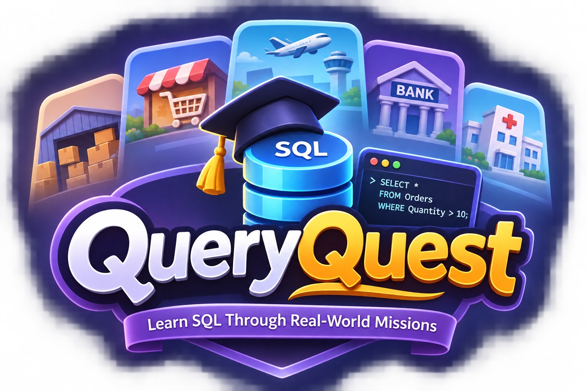

# QueryQuest

<p align="center">
  
</p>

<p align="center">
  <strong>Real-world problems. SQL-powered solutions.</strong>
</p>

<p align="center">
  <a href="#-getting-started"></a>
  <a href="#-technology-stack"></a>
  <a href="#-technology-stack"></a>
  <a href="#-license"></a>
</p>

QueryQuest is a modern, game-based SQL learning simulation where students learn SQL by stepping into authentic business environments called **Worlds** and solving realistic operational breakdowns.

Instead of reading dry tutorials or answering disconnected multiple-choice quizzes, students enter virtual organizations as database analysts, inspect live database schemas, write genuine SQL queries, troubleshoot broken inventory workflows, and compile dynamic executive business reports.

QueryQuest executes **real SQLite queries inside your browser via WebAssembly**, guaranteeing that every query runs against an authentic relational database engine with zero server latency.

---

## 🎴 3D Collectible World Cards

The dashboard presents world environments as interactive **3D collectible physical cards**:

- **Front Face**: High-resolution operational environment cover banner, company role, difficulty level, estimated completion time, target SQL concepts, mission progress bar, and immediate "Enter World" action.
- **Back Face (Operational Dossier)**: Company profile, database file name (`supermarket.db`), operational context brief, key analyst responsibilities, and mastered SQL topics.
- **Physical 3D Slab Depth**: Physical 14px slab thickness with realistic 3D edge walls, giving the cards a solid, collectible feel.
- **Gentle 3D Tilt**: Subtle cursor tilt dynamics reacting smoothly as your mouse glides over corners.
- **Card Flip Mechanics**: 1-click flip button or drag gesture with smooth spring animations.
- **Auto-Reset Safety Timer**: Cards flipped to the dossier face automatically flip back to the front after 60 seconds of inactivity.
- **Zero Scrollbars**: Compact, cleanly balanced layouts with 26px rounded corners designed to fit within boundaries without internal scrolling.

---

## 📸 Industry Worlds & Case Studies

QueryQuest features five distinct industry worlds, each designed around realistic relational database scenarios and authentic reference environments:

| World | Industry | Reference Environment | Difficulty | Time | SQL Focus | Status |
| :--- | :--- | :--- | :--- | :--- | :--- | :--- |
| **Supermarket Operations** | Retail & Consumer Goods | Checkout POS station, barcode scanning, grocery aisles | Beginner | 45m | `CREATE TABLE`, `INSERT`, `SELECT`, `UPDATE`, `DELETE`, `JOIN`, `GROUP BY`, `HAVING` | **Playable Now** |
| **Airport Operations** | Aviation & Logistics | Terminal concourse, departure boards (FIDS), aircraft tarmac | Intermediate | 60m | `JOIN`, `LEFT JOIN`, `NULL` handling, Aggregations, Subqueries, CTEs | Coming Soon |
| **Warehouse Management** | Logistics & Supply Chain | Automated conveyors, high-bay pallet racking, forklift telemetry | Intermediate | 50m | CRUD, Multi-table Joins, Date Filtering, Transactions | Coming Soon |
| **Hospital Administration** | Healthcare & Clinical | Clinical reception, admission desks, doctor-patient suites | Advanced | 65m | Multi-way Joins, `GROUP BY`, Date Functions, Window Functions | Coming Soon |
| **Bank Operations** | Banking & Financial Services | Commercial branch counter, tellers, transaction desks | Advanced | 75m | ACID Transactions, `BEGIN`/`COMMIT`/`ROLLBACK`, Audit logs, CTEs | Coming Soon |

---

## 🌟 Core Features & System Architecture

### 1. Genuine Client-Side SQLite Execution Engine
- **WebAssembly Powered**: Runs genuine SQLite 3 compiled to WebAssembly via `sql.js`.
- **Dedicated Web Worker**: All SQL compilation and execution occurs off the main thread in a dedicated Web Worker (`sql.worker.ts`), preventing UI lag, stutters, and page freezes.
- **Cartesian Protection**: 10-second watchdog execution timer guards against accidental infinite cartesian joins or runaway recursive Common Table Expressions.
- **Referential Integrity**: Foreign keys are enforced by default (`PRAGMA foreign_keys = ON;`).
- **Live Catalog Introspection**: Inspects internal tables (`sqlite_master`, `PRAGMA table_info`, `PRAGMA foreign_key_list`) to automatically extract column types, primary keys, and foreign key relations.
- **Microsecond Timing**: Measures query execution down to the exact millisecond (`ms`), reporting affected rows and returned row counts.

### 2. Professional Monaco SQL Editor & IDE
- **Syntax Highlighting & Autocomplete**: Complete SQLite grammar highlighting with SQL keyword suggestions.
- **Pixel-Perfect Caret Alignment**: Monaco font metrics are dynamically remeasured (`remeasureFonts()`) on mount and font load, ensuring zero cursor drift across long queries.
- **Isolated Monospace Typography**: Employs `Consolas`, `Fira Code`, and native monospace stacks with strict `letter-spacing: 0` and disabled font ligatures for consistent character advance widths.
- **Resizable 3-Column Layout**:
  - **Left Sidebar**: Mission Briefing, storyline, business problem, and progressive hints.
  - **Center Column**: Monaco SQL Editor (top) + Live Query Results Terminal (bottom).
  - **Right Sidebar**: Database Schema Explorer.
- **Smart Drag Splitters**:
  - Interactive resizers between panels with hover/active grip indicators.
  - **Strict Constraints**: Left sidebar minimum **240px**; Right sidebar minimum **200px**; Center compiler guaranteed at least **360px**.
  - **Double-Click Reset**: Snaps panels back to default widths (380px left, 280px right).
  - **Persistent Dimensions**: Custom widths saved to `localStorage` (`queryquest_left_width`, `queryquest_right_width`).
  - **Drag Shield**: Transparent overlay prevents editor from capturing mouse events during resize gestures.
- **Editor Controls**:
  - **Run Query** (`Ctrl+Enter` / `⌘+Enter`): Executes SQL in scratchpad mode.
  - **Submit Objective** (`Ctrl+Shift+Enter` / `⌘+Shift+Enter`): Evaluates query against mission objectives.
  - **Select All** button (`Ctrl+A` / `⌘+A`): One-click full query selection.
  - **Reset to Starter** (`RotateCcw`): Restores the mission's default SQL blueprint.
  - **Clear**: Clears the editor canvas.
  - **Query History**: Inspects the last 15 executed queries with execution time, row count, status, and click-to-load.
  - **Keyboard Shortcuts Modal**: Quick-reference modal for hotkeys.

### 3. Intelligent Mission Validation Engine
- Validates **actual database results and state changes**, not superficial string matching or brittle regular expressions.
- **Multi-Solution Flexibility**:
  - **Column Order Insensitive**: Students can write `SELECT name, price` or `SELECT price, name`.
  - **Case Insensitive Columns**: Handles `unit_price`, `Unit_Price`, and `UNIT_PRICE` identically.
  - **Numeric Normalization**: Normalizes floats and decimals (`12.5` equals `12.50`).
  - **Whitespace Normalization**: Ignores trailing whitespace, indentation differences, and line endings.
- **Validation Rule Types**:
  - `EXACT_MATCH`: Matches expected result rows and column sets.
  - `SUBSET_MATCH`: Ensures required key records are included.
  - `MIN_ROWS`: Validates minimum threshold of returned records.
  - `ORDER_INSENSITIVE`: Matches output rows regardless of ordering when not explicitly constrained.
  - `TABLE_EXISTS`: Inspects SQLite schema catalog to confirm tables were created with proper column types and constraints.
  - `DML_STATE_CHECK`: Runs secondary inspection queries to verify that `INSERT`, `UPDATE`, or `DELETE` statements mutated target rows without violating foreign keys.

### 4. Real-Time World Performance & Analytics Modal
- **Header "Performance" Pill**: Interactive pill in the workspace navigation bar for on-demand performance telemetry.
- **Progress Tracking**: Completed missions count, percentage progress bar, and remaining mission counters.
- **Live Time Tracking**: Measures exact active problem-solving seconds per task and overall cumulative world time.
- **Mistakes & Error Log**:
  - Automatically captures query syntax errors, runtime failures, and failed validation checks.
  - Calculates live query accuracy percentage.
  - **Interactive Mistakes Breakdown**: Expand any task row to view the historical list of exact error messages encountered during that mission.
- **Assistance Reliance**: Tracks progressive hint usage (0 to 3) per task.
- **Performance Rank & Assessment**: Computes operational rankings (*SQL Apprentice*, *Junior Database Technician*, *Operational SQL Specialist*, *Principal Data Architect*).
- **Mastered SQL Concepts**: Visual tags of all SQL keywords practiced in completed tasks.
- **Winning SQL Query**: Displays the student's passing SQL query with a 1-click clipboard copy button.

### 5. Interactive Database Schema Explorer
- **Collapsible Table Tree**: Displays all tables in the active world database with live row counts.
- **Instant Search Filter**: Quickly find tables in complex enterprise schemas.
- **Detailed Column Inspector**:
  - Column name and SQLite data type (`INTEGER`, `TEXT`, `REAL`, etc.).
  - Visual badges: `PK` (Primary Key in amber), `FK` (Foreign Key in sky blue), `NOT NULL`, `DEFAULT`.
- **Table Data Preview Modal**: Click the eye icon next to any table to preview its records in a tabular modal without writing a query manually.
- **One-Click Insert**: Click any table or column name to insert it directly into the Monaco editor.
- **Live Catalog Refresh**: Reloads catalog dynamically after `CREATE TABLE`, `ALTER TABLE`, or `DROP TABLE` operations.

### 6. Progressive Hints & Diagnostic Feedback
- **Educational SQLite Diagnostics**: Translates raw SQLite error messages into targeted guidance:
  - `no such table` &rarr; Suggests checking exact table spelling or creating it first.
  - `no such column` &rarr; Suggests valid column names and table aliases.
  - `near "...": syntax error` &rarr; Highlights missing commas, unclosed quotes, or misspelled keywords.
  - `FOREIGN KEY constraint failed` &rarr; Explains parent/child relationship requirements.
  - `UNIQUE constraint failed` &rarr; Identifies duplicate primary keys.
- **3-Tier Progressive Hints**:
  - Tier 1: Conceptual hint (High-level problem solving approach).
  - Tier 2: Directional hint (Which tables, clauses, or constraints to use).
  - Tier 3: Complete SQL blueprint snippet.
- **Full Solution Breakdown**: Step-by-step explanations available upon mission completion or after 3 attempts.

### 7. Dynamic Executive Business Reports
- Generates live business audit reports calculated entirely from real SQL queries on the active database:
  - **Executive Briefing Memo**: Narrative briefing for senior management.
  - **KPI Stat Counters**: Total gross revenue, stock units on hand, active reorder alerts.
  - **Lightweight SVG Bar Chart**: Visualizes category/department revenue breakdowns.
  - **Product Velocity Rankings Table**: Ranks best-selling products by units sold.
  - **Procurement Reorder List**: Flags low-stock items with shelf and bin locations.
  - **Print / PDF Export**: Formatted for executive sharing.

### 8. SQL Foundation Reference Hub
Integrated 9-module reference guide with practical blueprints and SQLite dialect rules:
- **Module 1**: Database Fundamentals (Tables, rows, schemas, primary keys, relationships).
- **Module 2**: Data Types (`INTEGER`, `TEXT`, `REAL`, `BLOB`, `NULL`, date/time handling).
- **Module 3**: Database & Table Creation (`CREATE TABLE`, `DROP`, `ALTER`, constraints).
- **Module 4**: Data Manipulation (`INSERT`, `UPDATE`, `DELETE`).
- **Module 5**: Data Querying (`SELECT`, `WHERE`, `DISTINCT`, `ORDER BY`, `LIMIT`, logical operators).
- **Module 6**: Constraints & Relationships (`PRIMARY KEY`, `FOREIGN KEY`, `NOT NULL`, `CHECK`, cardinality).
- **Module 7**: Joins (`INNER JOIN`, `LEFT JOIN`, `CROSS JOIN`, SQLite join semantics).
- **Module 8**: Aggregate Functions (`COUNT`, `SUM`, `AVG`, `MIN`, `MAX`, `GROUP BY`, `HAVING`).
- **Module 9**: Advanced SQL (Subqueries, Common Table Expressions `WITH`, `CASE`, `UNION`, Views).

### 9. Adaptive Themes (`slate-100` Light & `slate-950` Dark)
- **Default Theme**: **Slate-100 Light Mode** (`#f1f5f9`), crisp white surface cards (`bg-white`), dark slate typography, and emerald accents.
- **Header Theme Toggle**: Switch seamlessly between `slate-100` light and `slate-950` dark mode.
- **Monaco Synchronization**: Editor switches automatically between `vs` and `vs-dark` themes.
- **Persistence**: Theme selection is saved to `localStorage` (`queryquest_theme`).

### 10. Gamification & Audio Synthesizer
- **XP Progression & Levels**: Earn XP for solving missions, running queries, and completing worlds.
- **Badges & Achievements**: Unlock milestones like *First Query Executed*, *Workspace Architect*, *Join Master*, *Audit Specialist*, and *Report Producer*.
- **Procedural Sound Engine**: Powered by the Web Audio API without any external MP3/WAV downloads. Synthesizes click feedback, run query sounds, success chimes, and level-up flourishes. Can be muted anytime via the header toggle.

### 11. Offline Persistence (IndexedDB)
- Uses `idb` to persist complete SQLite database binary snapshots (`Uint8Array`) and mission telemetry per world.
- Changes survive browser reloads and offline sessions.
- **Workspace Reset**: Includes a "Reset DB" feature to re-seed initial clean datasets at any time.

---

## 🛒 World 1: Supermarket Operations (Playable Curriculum)

Students join **FreshMart Hypermarkets Ltd.** as a Junior Database Executive under Operations Manager Devendra.

### Database Schema (9 Tables)
1. `products` (`product_id`, `product_name`, `category_id`, `supplier_id`, `unit_price`, `cost_price`, `barcode`, `status`)
2. `categories` (`category_id`, `category_name`, `department`, `description`)
3. `suppliers` (`supplier_id`, `company_name`, `contact_name`, `phone`, `email`, `city`)
4. `customers` (`customer_id`, `first_name`, `last_name`, `email`, `phone`, `loyalty_tier`)
5. `employees` (`employee_id`, `first_name`, `last_name`, `role`, `department`, `salary`, `hire_date`)
6. `orders` (`order_id`, `customer_id`, `employee_id`, `order_date`, `total_amount`, `status`)
7. `order_items` (`item_id`, `order_id`, `product_id`, `quantity`, `unit_price`, `discount`)
8. `payments` (`payment_id`, `order_id`, `payment_method`, `amount`, `payment_date`, `status`)
9. `inventory` (`inventory_id`, `product_id`, `quantity_on_hand`, `reorder_level`, `shelf_location`, `last_restocked`)

### Missions
1. **Initialize Supermarket Store Workspace**: `CREATE TABLE store_branches` with `INTEGER PRIMARY KEY` and `NOT NULL` constraints.
2. **Create Product Categories Catalog**: `CREATE TABLE categories` with `AUTOINCREMENT` and `UNIQUE` constraints.
3. **Register New Vendor Partnership**: `INSERT INTO suppliers` with vendor contact information.
4. **Identify Low Stock & Depleted Shelves**: Filter `inventory` where `quantity_on_hand < reorder_level`.
5. **Correct Product Pricing Discrepancy**: Use `UPDATE products SET unit_price = ... WHERE product_name = ...` to fix pricing audits.
6. **Purge Discontinued Inventory Records**: Execute referentially safe `DELETE` queries on obsolete inventory items.
7. **Investigate Checkout Lane Error**: Build an `INNER JOIN` between `products` and `inventory` to diagnose out-of-stock register exceptions.
8. **Trace Customer Order Fulfillment**: Multi-table relational `JOIN` connecting `customers`, `orders`, and `order_items`.
9. **Analyze Category-Wise Revenue Performance**: Group sales by merchandise department using `GROUP BY`, `SUM()`, and `HAVING total_revenue > 1000`.
10. **Generate Final Supermarket Operations Deliverable**: Compute product velocity rankings and compile the live Executive Audit Report.

---

## ⚡ Performance & Bundle Metrics

| Metric | Measurement |
| :--- | :--- |
| **Gzipped JavaScript Bundle** | **~167 kB** (`dist/assets/index-*.js` including Monaco, SQLite WASM client, Lucide icons) |
| **Gzipped CSS Bundle** | **~9.1 kB** (`dist/assets/index-*.css`) |
| **Web Worker Bundle** | **44.4 kB** (`dist/assets/sql.worker-*.js`) |
| **Initial Boot Time** | **< 300 ms** in modern browsers |
| **Main Thread Overhead** | **0 ms** during query execution (isolated Web Worker) |

---

## 🛠️ Technology Stack

- **UI & Framework**: React 18, TypeScript, Tailwind CSS, Zustand, Lucide Icons
- **SQL Editor**: Monaco Editor (`@monaco-editor/react`) with dynamic remeasuring & Consolas monospace stack
- **SQL Engine**: SQLite 3 compiled to WebAssembly via `sql.js` (Web Worker isolation)
- **Local Persistence**: IndexedDB (`idb`)
- **Audio Synthesizer**: Web Audio API Procedural Synthesizer
- **Testing**: Vitest, React Testing Library, Playwright
- **Build Tooling**: Vite 6, PostCSS, TypeScript 5

---

## 💻 Getting Started

### Prerequisites
- Node.js 18+ (tested on Node 20 / 22 / 24)
- npm 9+

### Installation & Run

```bash
# Clone the repository
git clone https://github.com/shashaank747/QueryQuest.git
cd QueryQuest

# Install dependencies
npm install

# Start local development server
npm run dev
```

Visit **[http://localhost:3000](http://localhost:3000)** in your browser.

### Test Suite Execution

```bash
# Run Vitest automated test suite (18 unit & mission tests)
npm test

# Run tests in watch mode
npm run test:watch
```

### Production Build

```bash
# Type check and build optimized bundle
npm run build

# Preview production build locally
npm run preview
```

---

## ⌨️ Keyboard Shortcuts Reference

| Shortcut | Description |
| :--- | :--- |
| `Ctrl + Enter` / `⌘ + Enter` | Run SQL query in scratchpad mode |
| `Ctrl + Shift + Enter` / `⌘ + Shift + Enter` | Submit query for mission objective validation |
| `Ctrl + A` / `⌘ + A` | Select all query text in the editor |
| `Ctrl + /` / `⌘ + /` | Toggle SQL line comments (`--`) |
| `Tab` / `Shift + Tab` | Indent / Unindent selected lines |
| `Esc` | Close active modals and table preview dialogs |
| `Double-click splitter` | Reset left/right sidebar to default width |

---

## 👨‍💻 Creator & Engineering

Designed & Developed by **Shashaank Sajjanar**  
GitHub: [@shashaank747](https://github.com/shashaank747)

---

## 📄 License

QueryQuest is open-source software licensed under the **MIT License**.
